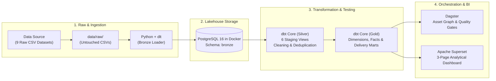

# Olist Order-to-Delivery Lakehouse

> **A production-grade, 100% open-source Lakehouse engineered to answer one core logistics question:**  
> *"Can Olist deliver on time, and where does it break down?"*

---

## 🏗️ Architecture



---

## 📋 The Core Delivery Question & Definitions

Every model, test, and chart in this lakehouse serves to isolate logistics performance and diagnose fulfillment breakdown:

- **Delivery Days**: Actual Delivered Date $-$ Purchase Timestamp
- **Promised Days**: Estimated Delivery Date $-$ Purchase Timestamp
- **Delay Days**: Actual Delivered Date $-$ Estimated Delivery Date ($> 0$ late, $\le 0$ on-time/early)
- **On-Time**: `delay_days <= 0`, evaluated **strictly on delivered orders**
- **Headline On-Time Rate**: $\frac{\text{On-Time Delivered Orders}}{\text{All Delivered Orders}}$
- **Cancellation Rate**: $\frac{\text{Canceled Orders}}{\text{All Orders}}$ *(tracked separately; never mixed into on-time rates)*
- **Freight Ratio**: $\frac{\text{Freight Value}}{\text{Product Price}}$

---

## 📊 Step 10: Key Analytical Findings & Insights

All numbers below were independently validated against PostgreSQL gold marts and match the Superset dashboards:

### 1. Headline On-Time Rate & What "Late" Means
- **Overall On-Time Delivery Rate**: **`91.88%`** (88,644 out of 96,478 delivered orders arrived on or before Olist's estimated date).
- **Average Delivery Time**: **`12.56 days`**.
- **Average Promised Buffer**: **`23.74 days`**.
- **Average Delay**: **`-11.18 days`** *(orders arrive on average ~11.2 days earlier than promised)*.
- **Order Lifecycle Breakdown**:
  - *Purchase $\rightarrow$ Payment Approval*: **0.43 days** (~10 hours)
  - *Approval $\rightarrow$ Carrier Dispatch*: **2.80 days** (~67 hours for seller packing)
  - *Carrier In-Transit $\rightarrow$ Customer Delivery*: **9.33 days** (**74.3% of the total customer wait time**).
- **Caveat**: "Late" is evaluated **only on delivered orders**. In-transit and canceled orders are excluded from the on-time denominator to avoid distorting the actual fulfillment delivery rate.

---

### 2. Best vs. Worst Customer States: The High-Volume Rio de Janeiro Bottleneck
- **Worst On-Time States (Northeast Corridor)**:
  - **Alagoas (AL)**: **`76.07%`** on-time (Avg delivery: 24.54 days, 397 orders).
  - **Maranhão (MA)**: **`80.33%`** on-time (Avg delivery: 21.57 days, 717 orders).
  - **Piauí (PI)**: **`84.03%`** on-time (Avg delivery: 19.46 days, 476 orders).
- **The Critical High-Volume Bottleneck — Rio de Janeiro (RJ)**:
  - **RJ** is Olist's **2nd largest market with 12,350 delivered orders**, located immediately adjacent to São Paulo (where 70%+ of sellers reside).
  - Despite geographical proximity, RJ's on-time rate collapses to **`86.53%`** (nearly **8 percentage points worse** than São Paulo at 94.09%), with an average delivery duration of 15.31 days.
  - *Why it matters*: Because of RJ's sheer scale, its 1,664 late orders account for **over 21% of all late deliveries across Brazil**. This is not small-sample noise; it indicates severe local carrier route bottlenecks and courier theft/security clearance issues in the RJ metropolitan area.
- **The Northern Promise Buffer Paradox (RO, AC, AM, AP)**:
  - Remote Northern states report high on-time rates (**95.5% – 97.1%**).
  - *Caveat*: Physical shipping takes nearly a month (**21 – 27 days**). The high on-time score is an artificial byproduct of algorithmically padded delivery estimates (**38 – 46 promised days**).

---

### 3. Seasonality vs. The 2018 Nationwide Logistics Crisis
- **Seasonal Surge (November 2017 - Black Friday)**:
  - Order volume jumped +63% from 4,631 to **7,544 orders**.
  - On-time delivery rate dropped from 94.71% to **`85.68%`** (1,044 late orders).
- **Acute Nationwide Crisis (February – March 2018)**:
  - In **February 2018**, on-time delivery dropped to **84.01%** (1,048 late orders).
  - In **March 2018**, performance collapsed to an all-time low of **`78.64%`** (**1,496 late deliveries** — more than 1 in 5 orders arrived late).
  - *Root Cause*: Early 2018 coincided with major Brazilian federal postal (Correios) fee increases, postal worker strikes, and preliminary transport strikes that crippled long-distance logistics.
- **Rapid Operational Recovery (April – June 2018)**:
  - Rebounded to 94.69% in April 2018 and achieved an **all-time peak of `98.59%` on-time delivery in June 2018** (average delivery duration of only 9.24 days).

---

### 4. Does a Longer Promised Delivery Time Go With More or Less Delay?
- **More Promise Buffer = Lower Probability of Delay**:
  - In remote states (RO, AC, AM, AP), setting a 40+ day estimated delivery window successfully prevents technical lateness despite slow ground transport.
  - In core regions (SP, PR), when Olist cut promised days to ~15 days in August 2018, average delivery days dropped to 7.73 days, but late deliveries increased to 10.39% due to tighter margins for error.

---

### 5. Freight Ratio vs. Late Delivery: Correlated Geographic Friction
- **Freight Burden by State**:
  - Remote North/Northeast states face double the freight penalty of São Paulo:
    - **Roraima (RR)**: **`28.55%`** freight-to-price ratio (Avg freight: R$ 42.98).
    - **Maranhão (MA)**: **`26.35%`** freight-to-price ratio (Avg freight: R$ 38.26).
    - **São Paulo (SP)**: **`13.81%`** freight-to-price ratio (Avg freight: R$ 15.15).
- **Freight Burden by Category**:
  - **Bulky / Heavy Goods**: Exceed **25%–29%** freight ratio (`electronics` 29.1%, `furniture_living_room` 26.1%, `office_furniture` 25.0%).
  - **Compact / High-Value Goods**: Below **8.4%** (`watches_gifts` 8.3%, `small_appliances` 8.4%).
- *Finding*: High freight ratios directly align with poor delivery performance at the state level (RR, MA, PI, AL have both the highest freight burdens and the longest shipping delays).

---

### 6. Cancellation Rate & Delivery Problems
- **Overall Cancellation Rate**: **`0.63%`** (625 canceled orders out of 99,441 total orders).
- **Correlation with Delivery Issues**: Orders canceled after shipment are rare; most cancellations occur during payment processing (0.43d) or pre-dispatch seller fulfillment (2.8d). Canceled orders are tracked separately and excluded from delivery KPI calculations.

---

## 🧹 Product Category Standardization & Data Cleaning

To eliminate fragmentation across 74 highly specific Portuguese-to-English translations (e.g., `furniture_mattress_and_upholstery`, `furniture_living_room`, `furniture_bedroom`), a comprehensive data cleaning rule groups all products into **17 standardized macro categories**:

- **Implementation Code**:
  - Python module: [`pipelines/clean_product_categories.py`](file:///d:/Work/Order-to-Delivery_Lakehouse/pipelines/clean_product_categories.py)
  - dbt macro: [`dbt_project/macros/clean_product_category.sql`](file:///d:/Work/Order-to-Delivery_Lakehouse/dbt_project/macros/clean_product_category.sql)
- **Downstream Lineage**: Enriched into `silver.stg_products`, `gold.dim_product`, and `gold.mart_order_items_enriched` under column **`product_category_group`**.

| Macro Category (`product_category_group`) | Granular Mappings (Examples) | Catalog Products | Order Items | % Share |
| :--- | :--- | :---: | :---: | :---: |
| **`home_and_garden`** | `bed_bath_table`, `housewares`, `garden_tools`, `home_confort` | 6,257 | 22,937 | 20.36% |
| **`computers_and_electronics`** | `computers_accessories`, `telephony`, `electronics`, `audio`, `computers` | 3,534 | 16,134 | 14.32% |
| **`health_and_beauty`** | `health_beauty`, `perfumery`, `diapers_and_hygiene` | 3,324 | 13,128 | 11.65% |
| **`furniture`** | `furniture_decor`, `office_furniture`, `furniture_living_room`, `furniture_bedroom`, `furniture_mattress_and_upholstery` | 3,271 | 10,956 | 9.73% |
| **`fashion_and_apparel`** | `fashion_bags_accessories`, `luggage_accessories`, `fashion_shoes`, `watches_gifts`, `fashion_clothing` | 2,899 | 9,725 | 8.63% |
| **`sports_and_leisure`** | `sports_leisure` | 2,867 | 8,641 | 7.67% |
| **`baby_and_toys`** | `toys`, `baby` | 2,330 | 7,182 | 6.38% |
| **`auto_and_parts`** | `auto` | 1,900 | 4,235 | 3.76% |
| **`tools_and_construction`** | `construction_tools_construction`, `home_construction`, `signaling_and_security` | 1,014 | 2,571 | 2.28% |
| **`appliances`** | `home_appliances`, `small_appliances`, `air_conditioning`, `home_appliances_2` | 856 | 2,076 | 1.84% |
| **`stationery_and_office`** | `stationery` | 849 | 2,517 | 2.23% |
| **`arts_hobbies_and_party`** | `consoles_games`, `musical_instruments`, `art`, `party_supplies`, `christmas_supplies` | 771 | 2,246 | 1.99% |
| **`pet_shop`** | `pet_shop` | 719 | 1,947 | 1.73% |
| **`food_and_beverages`** | `food_drink`, `food`, `drinks` | 267 | 1,167 | 1.04% |
| **`books_and_media`** | `books_general_interest`, `books_technical`, `books_imported`, `dvds_blu_ray`, `music` | 446 | 996 | 0.88% |
| **`industry_and_business`** | `agro_industry_and_commerce`, `industry_commerce_and_business`, `market_place` | 248 | 793 | 0.70% |
| **`other_or_uncategorized`** | `cool_stuff`, unmapped / NULL | 1,399 | 5,399 | 4.79% |

---

## 🗄️ Gold Layer Data Dictionary

All marts reside in PostgreSQL schema **`gold`**:

| Model Name | Materialization | Grain | Description |
| :--- | :---: | :--- | :--- |
| **`mart_delivery_performance`** | `table` | Order (`order_id`) | Order-level delivery KPIs, on-time boolean flags, stage duration breakdowns (approval, carrier handoff, transit), and item aggregates. |
| **`mart_delivery_daily`** | `table` | Day + State (`purchase_date`, `customer_state`) | Daily state-level summary of total orders, delivered, late, on-time rate, and average transit days for fast Superset trend charts. |
| **`mart_delivery_performance_enriched`** | `table` | Order (`order_id`) | Order grain joined with daily state benchmark metrics to measure individual order deviation from state-daily averages. |
| **`mart_state_freight_delivery`** | `table` | State (`customer_state`) | State-level consolidation of on-time rates, average delays, and freight ratios for scatter-plot correlation analysis. |
| **`mart_order_items_enriched`** | `table` | Item (`order_id`, `order_item_id`) | Fact order items enriched with product category translations, macro category groups (`product_category_group`), customer states, seller states, and freight ratios. |
| **`fact_order_items`** | `table` | Item (`order_id`, `order_item_id`) | Core fact table for revenue, price, and freight measures. |
| **`dim_customer`** | `table` | Customer (`customer_id`) | Customer geography (city, state, zip prefix) and unique customer identifiers. |
| **`dim_seller`** | `table` | Seller (`seller_id`) | Seller location attributes. |
| **`dim_product`** | `table` | Product (`product_id`) | Dimensions, weights, English category translations, and standardized macro category groups (`product_category_group`). |
| **`dim_date`** | `table` | Calendar Date (`date_day`) | Date dimension spanning 2016 through 2019. |

---

## 🚀 Step-by-Step Reproduction Guide

Follow these steps to reproduce the entire pipeline from scratch on your machine:

### Prerequisites
- Python 3.11+
- Docker & Docker Compose
- Data source credentials (or place the 9 CSV files directly into `data/raw/`)

### 1. Clone & Set Up Environment
```powershell
git clone <your-repo-url>
cd Order-to-Delivery_Lakehouse

# Create and activate virtual environment
python -m venv .venv
.\.venv\Scripts\Activate.ps1   # On Linux/macOS: source .venv/bin/activate

# Install dependencies
pip install -r requirements.txt
```

### 2. Configure Environment Variables
```powershell
cp .env.example .env
# Edit .env to set your PostgreSQL credentials and data source variables
```

### 3. Start PostgreSQL 16 & Superset Containers
```powershell
docker compose up -d
docker compose ps
# Ensure olist-postgres reports (healthy) on port 5432
```

### 4. Fetch Raw Data (Step 1)
```powershell
python pipelines/download_data.py
# Ingests the 9 raw CSV datasets into data/raw/ (idempotent: skips if all 9 CSVs exist)
```

### 5. Ingest Bronze Layer with dlt (Step 4)
```powershell
python pipelines/load_bronze.py
# Loads all 9 CSVs into PostgreSQL bronze schema and validates row counts against raw files
```

### 6. Build Silver & Gold Layers with dbt Core (Steps 5 & 6)
```powershell
cd dbt_project

# Check connection
dbt debug --profiles-dir .

# Build Silver staging views
dbt run --select staging --profiles-dir .

# Build Gold dimensions, facts, and delivery marts
dbt run --exclude staging --profiles-dir .

# Run all 63 data quality and relationship tests
dbt test --profiles-dir .

cd ..
```

### 7. Orchestrate via Dagster (Step 8)
```powershell
# Materialize all assets in sequence from terminal:
dagster asset materialize -f orchestration/dagster_assets.py --select "data_download,bronze_load,dbt_staging,dbt_marts,dbt_tests"

# Or launch the interactive Dagster UI:
dagster dev -f orchestration/dagster_assets.py -p 3001
# Open http://localhost:3001 to view the asset graph
```

### 8. View Superset Dashboards (Step 9)
```powershell
# Open http://localhost:8088 in your browser
# Datasets are pre-connected to PostgreSQL gold schema
```

---

## ⚠️ Known Limitations

1. **Historical Time Horizon**: Dataset ends in October 2018; observations reflect Brazilian infrastructure and postal logistics conditions as of 2016–2018.
2. **Geographic Scope**: Domestic Brazilian e-commerce only.
3. **No Carrier Attribution**: The raw Olist dataset does not record shipping carrier identity (e.g., Correios vs. private parcel couriers), preventing direct carrier-by-carrier SLA attribution.
4. **Olist Estimated Date vs. Carrier SLA**: The `order_estimated_delivery_date` represents Olist's algorithmic delivery promise displayed to the consumer at checkout, not a contractual third-party carrier commitment.
5. **No Geolocation Joins at Order Grain**: Raw geolocation data contains multiple coordinates per zip code prefix. To prevent Cartesian product fan-outs, geographic analysis is strictly modeled at state grain (`customer_state`, `seller_state`).

